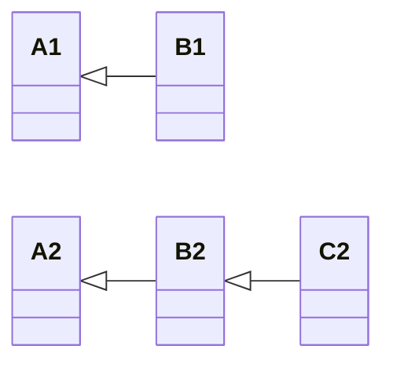
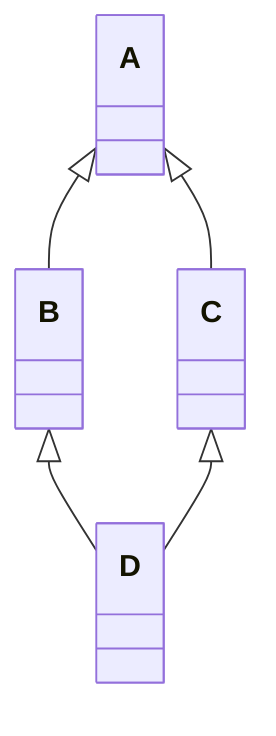

## Оглавление

1. Идея и зачем нужно наследование
2. Базовый синтаксис
3. Переопределение методов
4. `super()` и конструкторы
5. Виды наследования
6. Множественное наследование и MRO
7. Кооперативный `super()`
8. Миксины
9. Поиск атрибутов, атрибуты класса, name mangling
10. Классовые и статические методы при наследовании
11. Абстрактные классы как базовые
12. Наследование от встроенных типов
13. Магические методы и наследование
14. Хуки: `__init_subclass__`, `__subclasses__`
15. Композиция против наследования
16. Принцип подстановки Лисков (LSP)
17. Наследование и `dataclass`
18. Современные средства: `@final`, `@override`
19. Типичные ошибки

---

## 1. Идея

> [!note] Определение
> **Наследование** это механизм, при котором новый класс (**потомок**, подкласс, дочерний) получает атрибуты и методы существующего класса (**предка**, суперкласса, базового класса) и может их **расширять** или **переопределять**.

> [!tip] Аналогия
> Библиотека чертежей. Есть чертёж «Транспорт» (колёса, скорость, метод `move`). Чертёж «Автобус» не рисуют с нуля: берут «Транспорт» и добавляют то, что отличает автобус (пассажиры, остановки).

### Что даёт наследование

| Выгода | Пояснение |
|---|---|
| Повторное использование кода | Общее пишется один раз в предке |
| Расширяемость | Новые типы добавляются без правки старого кода |
| Иерархия типов | Можно работать с группой разных объектов через общий тип |
| Полиморфизм | Один интерфейс, разные реализации |

### Отношение «является» (is-a)

> [!important] Главный критерий
> Наследование уместно, если можно сказать «**Потомок является Предком**»: собака *является* животным, студент *является* человеком. Если фраза звучит странно («двигатель является машиной»), нужна **композиция** (раздел 15).

### Терминология

| Термин | Синонимы |
|---|---|
| Предок | родитель, базовый класс, суперкласс, parent, base class |
| Потомок | дочерний класс, подкласс, наследник, child, subclass, derived class |
| Переопределение | override |
| Расширение | extension |

---

## 2. Базовый синтаксис

```python
class Animal:                          # базовый класс
    def __init__(self, name):          # конструктор предка
        self.name = name               # атрибут экземпляра

    def eat(self):                     # метод предка
        print(f"{self.name} ест")

    def sleep(self):
        print(f"{self.name} спит")


class Dog(Animal):                     # Dog наследует Animal: родитель указывается в скобках
    def bark(self):                    # новый метод, которого у Animal нет
        print(f"{self.name}: Гав!")


d = Dog("Рекс")                        # __init__ взят у Animal
d.eat()                                # Рекс ест: метод унаследован
d.sleep()                              # Рекс спит: тоже унаследован
d.bark()                               # Рекс: Гав!: собственный метод
```

> [!info] Разбор
> У `Dog` нет своего `__init__`, `eat` и `sleep`, но они работают: Python не нашёл их в `Dog` и **поднялся** к `Animal`. Потомок получает всё, что есть у предка, и может добавлять своё. Обратное неверно: у `Animal` метода `bark` нет.

### Все классы наследуют `object`

```python
class A:             # то же самое, что class A(object):
    pass

print(A.__bases__)   # (<class 'object'>,)  непосредственные предки
print(A.__mro__)     # (<class '__main__.A'>, <class 'object'>)
```

> [!info] Разбор
> В Python 3 любой класс прямо или косвенно наследует `object`. Именно оттуда берутся базовые `__init__`, `__str__`, `__repr__`, `__eq__`, `__hash__` и другие.

### Проверка типов

```python
d = Dog("Рекс")

print(isinstance(d, Dog))        # True: d создан из Dog
print(isinstance(d, Animal))     # True: Dog является Animal (наследование!)
print(isinstance(d, object))     # True: всё является object

print(issubclass(Dog, Animal))   # True: Dog подкласс Animal
print(issubclass(Animal, Dog))   # False: обратное неверно

print(type(d) is Dog)            # True: точный тип
print(type(d) is Animal)         # False: type() не учитывает наследование
```

> [!tip] Что использовать
> `isinstance` учитывает наследование (почти всегда нужен он). `type(x) is C` проверяет **точный** тип, потомки не подходят.

### Что именно наследуется

```python
class Base:
    kind = "базовый"                   # атрибут КЛАССА

    def __init__(self):
        self.x = 1                     # атрибут ЭКЗЕМПЛЯРА (создаётся в __init__)

    def hello(self):                   # метод
        return "привет"

class Child(Base):
    pass

c = Child()
print(c.kind)        # базовый: атрибут класса унаследован
print(c.x)           # 1: __init__ унаследован и создал атрибут
print(c.hello())     # привет: метод унаследован
```

> [!info] Разбор
> Атрибуты **экземпляра** не наследуются сами по себе: они создаются кодом `__init__`. Если у потомка свой `__init__`, который не вызывает родительский, атрибута `x` не будет (см. раздел 4).

---

## 3. Переопределение методов (override)

Потомок может определить метод с тем же именем. Тогда используется **его** версия.

```python
class Animal:
    def __init__(self, name):
        self.name = name

    def speak(self):
        print(f"{self.name} издаёт звук")


class Dog(Animal):
    def speak(self):                   # переопределяем speak
        print(f"{self.name}: Гав!")


class Cat(Animal):
    def speak(self):                   # у каждого потомка своя реализация
        print(f"{self.name}: Мяу!")


class Fish(Animal):
    pass                               # speak не переопределён: работает версия Animal


for a in (Dog("Рекс"), Cat("Мурка"), Fish("Немо")):
    a.speak()
# Рекс: Гав!
# Мурка: Мяу!
# Немо издаёт звук
```

> [!info] Разбор
> Python выбирает метод **по реальному типу объекта**, а не по тому, как переменная названа. Цикл вызывает `a.speak()` одним и тем же кодом, а поведение разное. Это и есть полиморфизм, который держится на наследовании.

### Расширение вместо замены

Часто нужно не заменить поведение родителя, а **дополнить** его. Для этого вызывают родительский метод через `super()`:

```python
class Animal:
    def describe(self):
        return "Я животное"

class Dog(Animal):
    def describe(self):
        base = super().describe()            # берём результат родителя
        return base + ", а точнее собака"    # дополняем

print(Dog().describe())    # Я животное, а точнее собака
```

### Ручной вызов родителя (так делать не стоит)

```python
class Dog(Animal):
    def describe(self):
        return Animal.describe(self) + ", собака"   # явное имя родителя
```

> [!warning] Почему `super()` лучше
> Явное имя `Animal` жёстко привязывает код к конкретному предку. При смене родителя или при множественном наследовании всё сломается. `super()` сам находит нужный следующий класс (раздел 4 и 6).

---

## 4. `super()` и конструкторы

### 4.1 Проблема: потомок со своим `__init__`

```python
class Person:
    def __init__(self, name, age):
        self.name = name
        self.age = age

class Student(Person):
    def __init__(self, university):       # свой __init__ ЗАМЕНЯЕТ родительский
        self.university = university

s = Student("МГУ")
print(s.university)    # МГУ
print(s.name)          # AttributeError: родительский __init__ не вызывался!
```

> [!warning] Главная ошибка новичков
> Если в потомке определён `__init__`, родительский **не вызывается автоматически**. Атрибуты `name` и `age` просто не создаются.

### 4.2 Решение: `super().__init__(...)`

```python
class Person:
    def __init__(self, name, age):
        self.name = name                   # инициализация общих атрибутов
        self.age = age

class Student(Person):
    def __init__(self, name, age, university):
        super().__init__(name, age)        # доверяем родителю его часть работы
        self.university = university       # добавляем своё

s = Student("Анна", 20, "МГУ")
print(s.name, s.age, s.university)         # Анна 20 МГУ
```

> [!info] Разбор
> Потомок принимает **все** нужные аргументы: свои и родительские. Родительские передаются в `super().__init__`, остальные сохраняются самим потомком. Обычно `super().__init__()` вызывают **первой строкой**, чтобы родительская часть объекта была готова до того, как потомок начнёт её использовать.

### 4.3 Цепочка из трёх уровней

```python
class A:
    def __init__(self, a):
        self.a = a

class B(A):
    def __init__(self, a, b):
        super().__init__(a)                # вызывает A.__init__
        self.b = b

class C(B):
    def __init__(self, a, b, c):
        super().__init__(a, b)             # вызывает B.__init__, а тот A.__init__
        self.c = c

obj = C(1, 2, 3)
print(obj.__dict__)    # {'a': 1, 'b': 2, 'c': 3}
```

### 4.4 Как работает `super()` на самом деле

> [!important] Ключевая идея
> `super()` **не означает «родитель»**. Он означает «**следующий класс в MRO**» (порядке разрешения методов) относительно текущего класса. В одиночном наследовании это совпадает с родителем, но при множественном наследовании отличается (раздел 6).

Полная форма `super()` (в Python 3 писать не нужно, но полезно понимать):

```python
super(Student, self).__init__(name, age)   # старый стиль Python 2
super().__init__(name, age)                # современный: аргументы подставляются сами
```

> [!info] Разбор
> Пустой `super()` внутри метода класса знает, в каком классе он написан (через скрытую переменную `__class__`) и какой `self` используется. Он работает **только внутри методов**.

### 4.5 `super()` работает не только в `__init__`

```python
class Logger:
    def log(self, msg):
        print(f"LOG: {msg}")

class TimedLogger(Logger):
    def log(self, msg):
        import time
        super().log(f"[{time.strftime('%H:%M:%S')}] {msg}")   # расширяем поведение

TimedLogger().log("запуск")    # LOG: [12:30:45] запуск
```

### 4.6 Когда `super().__init__()` можно не вызывать

Если родительский `__init__` не делает ничего (как у `object`) или вы намеренно полностью заменяете инициализацию. Но это редкость и повод проверить дизайн.

---

## 5. Виды наследования



| Вид                | Схема                         | Пример                         |
| ------------------ | ----------------------------- | ------------------------------ |
| **Одиночное**      | `B(A)`                        | `Dog(Animal)`                  |
| **Многоуровневое** | `A → B → C`                   | `Animal → Dog → Puppy`         |
| **Иерархическое**  | `A → B`, `A → C`              | `Animal → Dog`, `Animal → Cat` |
| **Множественное**  | `C(A, B)`                     | `FlyingFish(Fish, Bird)`       |
| **Гибридное**      | комбинация вышеперечисленного | «ромб» (diamond)               |

```python
# Многоуровневое
class Animal: ...
class Dog(Animal): ...
class Puppy(Dog): ...

p = Puppy()
print(isinstance(p, Animal))   # True: Puppy → Dog → Animal

# Иерархическое
class Cat(Animal): ...         # у Animal теперь два потомка: Dog и Cat
```

> [!tip] Практический совет
> Глубокие иерархии (больше 3-4 уровней) тяжело читать и менять. Если глубина растёт, подумайте о композиции.

---

## 6. Множественное наследование и MRO

### 6.1 Синтаксис

```python
class Flyer:
    def move(self):
        print("Лечу")

class Swimmer:
    def move(self):
        print("Плыву")

class Duck(Flyer, Swimmer):    # два родителя
    pass

d = Duck()
d.move()                       # Лечу: у обоих родителей есть move, но...
```

> [!question] Почему «Лечу»?
> В обоих родителях есть `move`. Python выбирает по **MRO** (Method Resolution Order): порядок, в котором он просматривает классы.

### 6.2 Как посмотреть MRO

```python
print(Duck.__mro__)
# (<class 'Duck'>, <class 'Flyer'>, <class 'Swimmer'>, <class 'object'>)

print(Duck.mro())          # то же самое в виде списка
```

> [!info] Разбор
> Поиск идёт слева направо: сам `Duck` → `Flyer` → `Swimmer` → `object`. Первый найденный метод побеждает. Порядок родителей в скобках **имеет значение**: `Duck(Swimmer, Flyer)` дал бы «Плыву».

### 6.3 Проблема ромба (diamond problem)



```python
class A:
    def hello(self):
        print("A")

class B(A):
    def hello(self):
        print("B")

class C(A):
    def hello(self):
        print("C")

class D(B, C):          # ромб: D → B → A и D → C → A
    pass

D().hello()             # B
print(D.__mro__)
# D, B, C, A, object
```

> [!important] Что здесь важно
> Класс `A` стоит в MRO **после** и `B`, и `C`. Один и тот же класс не встречается дважды. Если бы Python шёл вглубь («D, B, A, C»), метод `A.hello` перекрыл бы более специфичный `C.hello`, и это было бы нелогично.

### 6.4 Алгоритм C3-линеаризации

Python строит MRO по алгоритму **C3**. Правила:

1. **Потомок раньше предка**.
2. **Порядок родителей слева направо** сохраняется, как в скобках.
3. Порядок внутри каждого родителя тоже сохраняется.

Формула: 

$$L[C] = C + \text{merge}(L[B_1], L[B_2], \dots, L[B_n], [B_1, B_2, \dots, B_n])$$

где `merge` берёт первый класс из первого списка, если он **не стоит в хвосте** (не первый элемент) других списков; иначе пробует следующий список.

**Пример вручную** для ромба `D(B, C)`:

```
L[A] = [A, object]
L[B] = [B, A, object]
L[C] = [C, A, object]

L[D] = D + merge([B, A, object], [C, A, object], [B, C])
     шаг 1: B   (B не в хвостах других списков) → берём
     шаг 2: A?  A есть в хвосте [C, A, object] → пропускаем; берём C
     шаг 3: A   теперь A нигде не в хвосте → берём
     шаг 4: object
L[D] = [D, B, C, A, object]
```

### 6.5 Когда MRO построить невозможно

```python
class A: ...
class B(A): ...

class C(A, B):    # TypeError: Cannot create a consistent method resolution order
    pass
```

> [!warning] Почему ошибка
> Запись `C(A, B)` требует, чтобы `A` был раньше `B`, но `B` наследует `A`, поэтому `B` обязан быть раньше `A`. Противоречие. Правильно: `class C(B, A)` или просто `class C(B)`.

### 6.6 Вызов метода конкретного родителя

```python
class D(B, C):
    def hello(self):
        B.hello(self)          # явно вызвать версию из B
        C.hello(self)          # и из C
```

> [!warning] Осторожно
> Прямые вызовы через имя класса обходят MRO и могут вызвать общий базовый метод **дважды**. Для согласованной цепочки используйте `super()` (раздел 7).

---

## 7. Кооперативный `super()`

### 7.1 `super()` идёт по MRO, а не к родителю

```python
class A:
    def hello(self):
        print("A")

class B(A):
    def hello(self):
        print("B начало")
        super().hello()               # КТО здесь «super»? Зависит от MRO объекта!
        print("B конец")

class C(A):
    def hello(self):
        print("C начало")
        super().hello()
        print("C конец")

class D(B, C):
    def hello(self):
        print("D начало")
        super().hello()
        print("D конец")

D().hello()
```

Вывод:

```
D начало
B начало
C начало
A
C конец
B конец
D конец
```

> [!info] Разбор
> MRO объекта `D`: `D → B → C → A → object`. `super()` в `B` вызывает **не `A`, а `C`**, потому что `C` следующий в MRO после `B` для объекта типа `D`. Каждый метод вызывает `super()`, и в итоге каждый класс выполняется **ровно один раз**. Это называется **кооперативным множественным наследованием**.

> [!important] Правило кооперации
> Если класс участвует в множественном наследовании, **все** его методы должны вызывать `super().метод(...)`, иначе цепочка оборвётся.

### 7.2 Конструкторы в ромбе

Проблема: разные классы принимают разные аргументы, а `super().__init__()` передаёт управление неизвестному соседу. Стандартное решение: **именованные аргументы** и `**kwargs`.

```python
class Base:
    def __init__(self, **kwargs):
        print("Base init")
        super().__init__(**kwargs)          # доходим до object, kwargs уже должны быть пусты

class Named(Base):
    def __init__(self, name, **kwargs):     # забираем свой аргумент
        print("Named init")
        super().__init__(**kwargs)          # остальное передаём дальше
        self.name = name

class Aged(Base):
    def __init__(self, age, **kwargs):
        print("Aged init")
        super().__init__(**kwargs)
        self.age = age

class Person(Named, Aged):
    def __init__(self, **kwargs):
        print("Person init")
        super().__init__(**kwargs)

p = Person(name="Анна", age=20)
# Person init → Named init → Aged init → Base init
print(p.name, p.age)                        # Анна 20
```

> [!info] Разбор
> Каждый класс «забирает» из `**kwargs` свой аргумент по имени и передаёт остальное дальше по цепочке MRO. Благодаря этому классы не обязаны знать, кто стоит рядом.

> [!warning] Подводный камень
> Если какой-то аргумент никто не забрал, `object.__init__` выбросит `TypeError: object.__init__() takes exactly one argument`.

---

## 8. Миксины (Mixins)

> [!note] Определение
> **Миксин** это небольшой класс, который **добавляет одну возможность** другим классам и сам по себе не предназначен для самостоятельного использования. Подмешивается через множественное наследование.

```python
import json

class JsonMixin:                                   # добавляет сериализацию в JSON
    def to_json(self):
        return json.dumps(vars(self), ensure_ascii=False)   # vars: словарь атрибутов

class ReprMixin:                                   # добавляет красивый __repr__
    def __repr__(self):
        attrs = ", ".join(f"{k}={v!r}" for k, v in vars(self).items())
        return f"{type(self).__name__}({attrs})"   # имя РЕАЛЬНОГО класса объекта

class Person:
    def __init__(self, name, age):
        self.name = name
        self.age = age

class SmartPerson(JsonMixin, ReprMixin, Person):   # миксины слева, основной класс справа
    pass

p = SmartPerson("Анна", 20)
print(p)             # SmartPerson(name='Анна', age=20)
print(p.to_json())   # {"name": "Анна", "age": 20}
```

> [!info] Разбор
> Каждый миксин отвечает за одну функцию и не зависит от конкретного класса. Это безопаснее «настоящего» множественного наследования: нет конфликтов данных.

### Правила хорошего миксина

> [!tip] Чек-лист
> 1. Не имеет своего состояния (или минимальное) и не определяет `__init__`.
> 2. Делает **одну** вещь (имя оканчивается на `Mixin`).
> 3. Ставится **левее** основного класса в списке родителей (чтобы его методы стояли раньше в MRO).
> 4. Если переопределяет метод, обязательно вызывает `super()`.
> 5. Не должен создаваться отдельно.

### Миксин, расширяющий поведение

```python
class LoggingMixin:
    def save(self):
        print(f"[LOG] перед сохранением {self!r}")
        result = super().save()                    # вызываем save следующего в MRO
        print("[LOG] после сохранения")
        return result

class Model:
    def save(self):
        print("Сохраняем в БД")
        return True

class User(LoggingMixin, Model):                   # миксин ЛЕВЕЕ, иначе не сработает
    pass

User().save()
# [LOG] перед сохранением <...User object...>
# Сохраняем в БД
# [LOG] после сохранения
```

---

## 9. Поиск атрибутов, атрибуты класса, name mangling

### 9.1 Порядок поиска `obj.attr`

1. В `obj.__dict__` (атрибуты экземпляра).
2. В классе объекта, затем по цепочке **MRO** родителей (атрибуты и методы классов).
3. Если не найдено, вызывается `__getattr__` (если определён), иначе `AttributeError`.

> [!note] Уточнение
> Дескрипторы данных, например `property`, проверяются **раньше** `__dict__` экземпляра. Подробнее в теме о дескрипторах.

```python
class Parent:
    x = "родитель"

class Child(Parent):
    pass

c = Child()
print(c.x)           # родитель: найден в Parent по MRO
Child.x = "потомок"  # создаём атрибут в Child, он перекрывает родительский
print(c.x)           # потомок
print(Parent.x)      # родитель: родитель не изменился
```

### 9.2 Ловушка: изменяемый атрибут класса

```python
class Base:
    items = []                 # ОДИН список на Base и ВСЕХ потомков

class A(Base): ...
class B(Base): ...

A.items.append(1)
print(B.items)                 # [1]: общий список!
```

Исправление: у каждого потомка свой список или создавать в `__init__`.

### 9.3 Ловушка: присваивание через экземпляр

```python
class Base:
    count = 0

class Child(Base): ...

c = Child()
c.count += 1                   # читаем Base.count (0), создаём c.count = 1 у ОБЪЕКТА
print(c.count, Base.count)     # 1 0
```

> [!info] Разбор
> `c.count += 1` это `c.count = c.count + 1`. Справа читается значение класса, слева записывается атрибут **экземпляра**. Чтобы менять счётчик класса, пишите `Base.count += 1` или `type(self).count += 1`.

### 9.4 Name mangling и наследование

```python
class Parent:
    def __init__(self):
        self.__secret = "родитель"      # на самом деле _Parent__secret

    def reveal(self):
        return self.__secret            # ищет _Parent__secret

class Child(Parent):
    def __init__(self):
        super().__init__()
        self.__secret = "потомок"       # на самом деле _Child__secret: другое имя!

c = Child()
print(c.reveal())                       # родитель
print(c.__dict__)                       # {'_Parent__secret': 'родитель', '_Child__secret': 'потомок'}
```

> [!info] Разбор
> Двойное подчёркивание превращает имя в `_ИмяКласса__атрибут`, поэтому атрибуты родителя и потомка с одинаковыми именами не конфликтуют. Именно **для этого** `__name` и придуман, а не для защиты данных.

### 9.5 Уровни доступа в иерархии

| Запись | Видно в потомке? | Смысл |
|---|---|---|
| `name` | да | публичный интерфейс |
| `_name` | да (по соглашению: для потомков и самого класса) | «защищённый» |
| `__name` | не по обычному имени (имя изменено) | «приватный» для конкретного класса |

> [!tip] Практика
> Чтобы потомки могли использовать внутренние детали, называйте их `_name`. Если не хотите, чтобы потомок случайно переопределил внутренний метод, используйте `__name`.

---

## 10. `@classmethod` и `@staticmethod` при наследовании

### 10.1 Альтернативные конструкторы

```python
class Person:
    def __init__(self, name, age):
        self.name = name
        self.age = age

    @classmethod
    def from_string(cls, text):              # cls: КЛАСС, из которого вызвали
        name, age = text.split(",")
        return cls(name.strip(), int(age))   # создаём объект именно ТОГО класса

    def __repr__(self):
        return f"{type(self).__name__}({self.name!r}, {self.age})"

class Student(Person):
    pass

print(Person.from_string("Анна, 20"))        # Person('Анна', 20)
print(Student.from_string("Иван, 19"))       # Student('Иван', 19)
```

> [!info] Разбор
> Благодаря `cls` конструктор **работает для потомков без переопределения**: `Student.from_string` создаёт `Student`. Если бы внутри было жёстко написано `Person(...)`, всегда возвращался бы `Person`. Поэтому в фабричных методах пишут `cls(...)`, а не имя класса.

### 10.2 Статические методы

```python
class Validator:
    @staticmethod
    def is_positive(x):                      # не использует ни self, ни cls
        return x > 0

class StrictValidator(Validator):
    @staticmethod
    def is_positive(x):                      # можно переопределить, как и обычный
        return x > 0 and isinstance(x, int)
```

> [!tip] Различие
> `classmethod` знает, **из какого класса** его вызвали (получает `cls`), поэтому учитывает наследование. `staticmethod` ничего не знает о классе, это обычная функция «в пространстве имён» класса.

### 10.3 `super()` в методе класса

```python
class Base:
    @classmethod
    def create(cls):
        print(f"Base.create для {cls.__name__}")
        return cls()

class Child(Base):
    @classmethod
    def create(cls):
        print("Child.create")
        return super().create()              # cls остаётся Child

Child.create()
# Child.create
# Base.create для Child
```

---

## 11. Абстрактные классы как базовые

> [!note] Суть
> **Абстрактный класс** задаёт контракт: потомки **обязаны** реализовать определённые методы. Экземпляр абстрактного класса создать нельзя.

```python
from abc import ABC, abstractmethod

class Shape(ABC):                          # ABC делает класс абстрактным
    @abstractmethod
    def area(self):                        # потомки ОБЯЗАНЫ реализовать
        ...

    @abstractmethod
    def perimeter(self):
        ...

    def describe(self):                    # обычный метод: общая логика на базе контракта
        return f"{type(self).__name__}: S={self.area():.2f}, P={self.perimeter():.2f}"


class Rectangle(Shape):
    def __init__(self, w, h):
        self.w, self.h = w, h

    def area(self):
        return self.w * self.h

    def perimeter(self):
        return 2 * (self.w + self.h)


class Broken(Shape):
    def area(self):                        # perimeter не реализован
        return 0


# Shape()                                  # TypeError: нельзя создать абстрактный класс
# Broken()                                 # TypeError: не реализован perimeter
print(Rectangle(3, 4).describe())          # Rectangle: S=12.00, P=14.00
```

> [!info] Разбор
> Ошибка возникает **при создании объекта**, а не при вызове метода. Это раннее обнаружение пропущенной реализации. Метод `describe` в базе использует `self.area()`: он работает для любого потомка, который выполнил контракт (паттерн «шаблонный метод»).

### Шаблонный метод

```python
class Report(ABC):
    def build(self):                       # ФИКСИРОВАННЫЙ алгоритм в предке
        data = self.collect()
        text = self.format(data)
        return self.finalize(text)

    @abstractmethod
    def collect(self): ...                 # шаги, которые определяют потомки

    @abstractmethod
    def format(self, data): ...

    def finalize(self, text):              # шаг с реализацией по умолчанию
        return text.strip()
```

---

## 12. Наследование от встроенных типов

### 12.1 Простой случай: добавляем методы

```python
class MyList(list):                        # список с дополнительным методом
    def second(self):
        return self[1]

ml = MyList([1, 2, 3])
print(ml.second())    # 2
print(len(ml))        # 3: всё остальное работает как у list
```

### 12.2 Ловушка: переопределённые методы не вызываются внутри встроенных

```python
class DoubleDict(dict):
    def __setitem__(self, key, value):
        super().__setitem__(key, value * 2)     # удваиваем значение

d = DoubleDict()
d["a"] = 1
print(d["a"])           # 2: работает через []

d2 = DoubleDict(b=5)    # конструктор dict НЕ вызывает наш __setitem__
print(d2["b"])          # 5, а не 10!

d2.update(c=7)          # update тоже обходит __setitem__
print(d2["c"])          # 7, а не 14!
```

> [!warning] Почему так
> Встроенные типы реализованы на C и внутри себя не обращаются к переопределённым методам Python ради скорости. Поведение получается непоследовательным.

### 12.3 Решение: `UserDict`, `UserList`, `UserString`

```python
from collections import UserDict

class DoubleDict(UserDict):                     # написан на Python, обычные правила
    def __setitem__(self, key, value):
        super().__setitem__(key, value * 2)

d = DoubleDict(b=5)
d.update(c=7)
print(d["b"], d["c"])      # 10 14: все пути записи идут через наш __setitem__
```

> [!tip] Правило
> Если нужно **изменить поведение** встроенного контейнера, наследуйтесь от `UserDict`/`UserList` (или `collections.abc`). Если только **добавить методы**, можно наследоваться от `dict`/`list`.

### 12.4 Наследование от неизменяемых типов

Для `int`, `str`, `tuple` значение задаётся в `__new__`, а не в `__init__`:

```python
class PositiveInt(int):
    def __new__(cls, value):                    # __new__ СОЗДАЁТ объект
        if value <= 0:
            raise ValueError("Должно быть положительным")
        return super().__new__(cls, value)      # создаём настоящий int

x = PositiveInt(5)
print(x + 3, isinstance(x, int))    # 8 True
# PositiveInt(-1)                   # ValueError
```

> [!info] Разбор
> `int` неизменяем: после создания значение не поменять, поэтому проверку нужно делать **до** создания. `__new__` вызывается раньше `__init__` и возвращает объект.

### 12.5 Наследование от исключений

```python
class AppError(Exception):                  # базовое исключение приложения
    pass

class ValidationError(AppError):            # иерархия исключений
    def __init__(self, field, message):
        super().__init__(f"{field}: {message}")
        self.field = field

class NotFoundError(AppError):
    pass

try:
    raise ValidationError("age", "должен быть положительным")
except AppError as e:                       # ловим по базовому типу
    print("Ошибка приложения:", e)          # Ошибка приложения: age: должен быть положительным
```

> [!tip] Зачем иерархия исключений
> `except AppError` перехватывает **любое** исключение приложения, а `except ValidationError` только конкретное. Порядок `except` важен: сначала узкие типы, затем широкие.

---

## 13. Магические методы и наследование

### 13.1 Магические методы наследуются как обычные

```python
class Point:
    def __init__(self, x, y):
        self.x, self.y = x, y

    def __repr__(self):
        return f"{type(self).__name__}({self.x}, {self.y})"   # type(self): имя реального класса!

    def __eq__(self, other):
        return (self.x, self.y) == (other.x, other.y)

class Point3D(Point):
    def __init__(self, x, y, z):
        super().__init__(x, y)
        self.z = z

print(Point3D(1, 2, 3))      # Point3D(1, 2): z не выведен, надо расширить __repr__
```

> [!info] Разбор
> Пишите `type(self).__name__`, а не жёсткое `"Point"`, тогда `__repr__` правильно называет потомков. Но если у потомка новые поля, `__repr__` и `__eq__` нужно расширять.

### 13.2 Расширение `__eq__` и `__repr__`

```python
class Point3D(Point):
    def __init__(self, x, y, z):
        super().__init__(x, y)
        self.z = z

    def __repr__(self):
        return f"{type(self).__name__}({self.x}, {self.y}, {self.z})"

    def __eq__(self, other):
        if not isinstance(other, Point3D):
            return NotImplemented                   # «не умею сравнивать с таким типом»
        return super().__eq__(other) and self.z == other.z
```

### 13.3 Ловушка `__eq__` и `__hash__`

```python
class A:
    def __eq__(self, other):
        return True

# hash(A()) → TypeError: unhashable type
```

> [!warning] Правило
> Если в классе определён `__eq__` без `__hash__`, Python устанавливает `__hash__ = None`, и объекты нельзя класть в `set` или использовать как ключи. Это относится и к **потомкам**: если потомок переопределяет `__eq__`, он теряет хеш родителя. Нужно явно написать `__hash__`.

### 13.4 `NotImplemented` и порядок вызова бинарных операторов

```python
class A:
    def __add__(self, other):
        return "A.__add__"

class B(A):
    def __radd__(self, other):
        return "B.__radd__"

print(A() + B())     # B.__radd__
```

> [!info] Разбор
> Если правый операнд является **подклассом** левого и переопределяет отражённый метод, Python вызывает **его в первую очередь**. Это позволяет потомку «перехватить» операцию с предком.

---

## 14. Хуки: `__init_subclass__` и `__subclasses__`

### 14.1 `__subclasses__()`: найти потомков

```python
class Plugin: ...
class CsvPlugin(Plugin): ...
class JsonPlugin(Plugin): ...

print(Plugin.__subclasses__())    # [<class 'CsvPlugin'>, <class 'JsonPlugin'>]
```

> [!info] Разбор
> Возвращает только **непосредственных** потомков. Для всех уровней нужна рекурсия.

### 14.2 `__init_subclass__`: реакция на создание подкласса

```python
class Plugin:
    registry = {}                                  # реестр плагинов

    def __init_subclass__(cls, /, name=None, **kwargs):
        super().__init_subclass__(**kwargs)        # цепочка для кооперации
        Plugin.registry[name or cls.__name__] = cls   # регистрируем потомка автоматически

class CsvPlugin(Plugin, name="csv"):               # параметр передаётся в ключевых аргументах
    pass

class JsonPlugin(Plugin):                          # без name: имя класса
    pass

print(Plugin.registry)
# {'csv': <class 'CsvPlugin'>, 'JsonPlugin': <class 'JsonPlugin'>}
```

> [!info] Разбор
> Метод вызывается **автоматически** при создании каждого подкласса. Это простая замена метаклассам и декораторам-регистраторам: потомки сами попадают в реестр, достаточно просто унаследоваться. `__init_subclass__` неявно является методом класса (`cls` это новый потомок).

---

## 15. Композиция против наследования

> [!important] Правило
> **Предпочитайте композицию наследованию.** Наследование это самая сильная связь между классами: потомок зависит от внутренностей предка.

| | Наследование | Композиция |
|---|---|---|
| Отношение | «является» (is-a) | «имеет» (has-a) |
| Связь | жёсткая, фиксируется при объявлении класса | гибкая, можно менять объект во время работы |
| Доступ | потомок видит внутренности предка | работа только через публичный интерфейс |
| Риск | хрупкий базовый класс, раздутые иерархии | немного больше кода-«переходников» |

### Пример: неправильное наследование

```python
class Stack(list):             # Stack ЯВЛЯЕТСЯ list?
    def push(self, x):
        self.append(x)

s = Stack()
s.push(1)
s.insert(0, 99)                # утечка интерфейса: у стека нельзя вставлять в середину
s.sort()                       # и сортировать тоже
```

> [!warning] Проблема
> Потомок наследует **весь** интерфейс `list`, включая методы, которые нарушают смысл стека (LIFO).

### Решение: композиция

```python
class Stack:
    def __init__(self):
        self._items = []                 # внутри хранится список, но он скрыт

    def push(self, x):
        self._items.append(x)

    def pop(self):
        return self._items.pop()         # снимаем верхний элемент

    def peek(self):
        return self._items[-1]

    def __len__(self):
        return len(self._items)

    def __bool__(self):
        return bool(self._items)
```

> [!info] Разбор
> Теперь у стека **только нужный интерфейс**. Внутреннюю реализацию (список, `deque`) можно поменять, и внешний код не заметит.

### Композиция + делегирование

```python
class Engine:
    def start(self):
        print("Двигатель запущен")

class Car:
    def __init__(self, engine):            # внедряем зависимость: можно подставить любой двигатель
        self._engine = engine

    def start(self):
        self._engine.start()               # делегируем работу вложенному объекту

Car(Engine()).start()
```

### Как выбирать

| Вопрос | Ответ → решение |
|---|---|
| Фраза «B является A» верна **всегда** (во всех контекстах)? | да → наследование |
| Нужно использовать только часть интерфейса A? | да → композиция |
| Нужно менять поведение во время работы? | да → композиция (стратегия) |
| Нужна только готовая функциональность A? | композиция |
| Нужен полиморфизм (общий тип для разных классов)? | наследование (или Protocol / абстрактный класс) |

---

## 16. Принцип подстановки Лисков (LSP)

> [!note] Формулировка
> Объект потомка должен **безопасно подставляться** вместо объекта предка: код, работающий с предком, не должен ломаться и не должен знать о потомке.

### Классическое нарушение: Квадрат и Прямоугольник

```python
class Rectangle:
    def __init__(self, w, h):
        self.w, self.h = w, h

    def set_width(self, w):
        self.w = w

    def set_height(self, h):
        self.h = h

    def area(self):
        return self.w * self.h


class Square(Rectangle):                   # в математике квадрат это прямоугольник...
    def set_width(self, w):
        self.w = self.h = w                # ...но обязан держать стороны равными

    def set_height(self, h):
        self.w = self.h = h


def stretch(rect):                         # код, написанный для Rectangle
    rect.set_width(5)
    rect.set_height(2)
    assert rect.area() == 10               # ожидание: 5 * 2

stretch(Rectangle(1, 1))                   # OK
stretch(Square(1, 1))                      # AssertionError: площадь 4
```

> [!warning] Вывод
> Математическое «является» не гарантирует корректного наследования. Важно **поведение**: изменяемый квадрат не ведёт себя как изменяемый прямоугольник.

### Признаки нарушения LSP

> [!tip] Тревожные сигналы
> 1. Потомок **выбрасывает исключение** там, где предок работал (`NotImplementedError` в унаследованном методе).
> 2. Потомок **ужесточает** требования к аргументам (предок принимал любые числа, потомок только положительные).
> 3. Потомок **ослабляет** результат (предок гарантировал не-`None`, потомок возвращает `None`).
> 4. В коде появляются `if isinstance(obj, Child)`.
> 5. Потомок меняет смысл метода (метод `save` вдруг удаляет).

### Решения

```python
from abc import ABC, abstractmethod

class Shape(ABC):                          # общий интерфейс без лишних обещаний
    @abstractmethod
    def area(self): ...

class Rectangle(Shape):
    def __init__(self, w, h):
        self.w, self.h = w, h
    def area(self):
        return self.w * self.h

class Square(Shape):                       # Square больше не потомок Rectangle
    def __init__(self, a):
        self.a = a
    def area(self):
        return self.a ** 2
```

Альтернатива: сделать фигуры **неизменяемыми** (`frozen dataclass`), тогда проблемы с сеттерами исчезают.

---

## 17. Наследование и `dataclass`

```python
from dataclasses import dataclass

@dataclass
class Person:
    name: str
    age: int

@dataclass
class Student(Person):                     # поля родителя идут ПЕРВЫМИ
    university: str

s = Student("Анна", 20, "МГУ")
print(s)    # Student(name='Анна', age=20, university='МГУ')
```

### Ловушка: поля со значениями по умолчанию

```python
@dataclass
class Base:
    name: str
    active: bool = True                    # поле с умолчанием

@dataclass
class Child(Base):
    extra: int                             # TypeError: поле без умолчания после поля с умолчанием
```

> [!warning] Почему
> Поля собираются в порядке MRO (сначала родитель), а параметры без значений по умолчанию не могут стоять после параметров со значением. Решения: задать умолчание и в потомке, либо использовать `kw_only=True` (Python 3.10+):

```python
@dataclass(kw_only=True)
class Child(Base):
    extra: int                             # теперь только по имени: Child(name="a", extra=1)
```

---

## 18. Современные средства: `@final` и `@override`

```python
from typing import final, override       # override: Python 3.12+

class Base:
    @final                                # метод нельзя переопределять
    def critical(self):
        return "нельзя менять"

    def run(self):
        return "base"

@final                                    # от класса нельзя наследоваться
class Leaf(Base):
    @override                             # явно отмечаем: переопределяем метод предка
    def run(self):
        return "leaf"
```

> [!info] Разбор
> Эти декораторы работают для **статических анализаторов** (mypy, pyright, IDE), во время выполнения запрета нет. `@override` защищает от опечаток: если в предке метода `run` нет (или переименовали), анализатор сообщит об ошибке, а не создаст новый метод незаметно.

---

## 19. Типичные ошибки

> [!warning] Проверьте свой код
> 1. **Забыли `super().__init__()`**: атрибуты родителя не созданы, `AttributeError`.
> 2. **Наследование ради повторного использования кода**, когда нет отношения «является» (нужна композиция).
> 3. **Слишком глубокая иерархия**: тяжело понимать, где определён метод.
> 4. **Не вызывают `super()` в методах множественного наследования**: цепочка обрывается.
> 5. **Изменяемый атрибут класса** (список, словарь), общий для всех потомков.
> 6. **Жёстко прописанное имя родителя** (`Parent.method(self)`) вместо `super()`.
> 7. **Нарушение LSP**: потомок ломает контракт предка.
> 8. **Наследование от `list`/`dict`** с переопределением методов (нужны `UserList`/`UserDict`).
> 9. **Переопределили `__eq__` и потеряли `__hash__`**.
> 10. **Противоречивый порядок родителей** `class C(A, B)`, где `B` наследует `A`.
> 11. **Фабричный метод возвращает `Parent(...)`**, а не `cls(...)`: потомки получают объект предка.
> 12. **Миксин поставлен правее основного класса**: его методы никогда не вызываются.

---

##  Шпаргалка

| Что | Как |
|---|---|
| Унаследоваться | `class Child(Parent):` |
| Вызвать родителя | `super().method(...)` |
| Конструктор родителя | `super().__init__(...)` |
| Посмотреть порядок поиска | `Cls.__mro__`, `Cls.mro()` |
| Прямые родители | `Cls.__bases__` |
| Прямые потомки | `Cls.__subclasses__()` |
| Проверить экземпляр | `isinstance(obj, Cls)` |
| Проверить подкласс | `issubclass(Child, Parent)` |
| Обязать реализовать метод | `ABC` + `@abstractmethod` |
| Подмешать возможность | миксин слева от основного класса |
| Фабрика, работающая для потомков | `@classmethod` и `cls(...)` |
| Изменить поведение `dict`/`list` | `UserDict`/`UserList` |
| Запретить переопределение | `@final` (проверяется анализатором) |

---

##  Задания

> [!question] Задание 1: Животные
> Создайте базовый класс `Animal` с атрибутом `name` и методом `speak()`, возвращающим `"..."`. Создайте потомков `Dog` («Гав»), `Cat` («Мяу») и `Cow` («Муу»). В цикле выведите голоса списка животных.

> [!question] Задание 2: Сотрудники
> Класс `Employee(name, salary)` с методом `get_pay()`. Потомок `Manager` добавляет `bonus` и прибавляет его к зарплате. Потомок `Developer` добавляет `overtime_hours` и платит 500 за каждый час сверхурочных. Вызовите `super()` везде, где это уместно. Посчитайте общий фонд оплаты для списка сотрудников.

> [!question] Задание 3: Предскажите вывод
> ```python
> class A:
>     def __init__(self):
>         print("A init")
>
> class B(A):
>     def __init__(self):
>         print("B init")
>         super().__init__()
>
> class C(A):
>     def __init__(self):
>         print("C init")
>         super().__init__()
>
> class D(B, C):
>     def __init__(self):
>         print("D init")
>         super().__init__()
>
> D()
> print([c.__name__ for c in D.__mro__])
> ```

> [!question] Задание 4: Найдите ошибку
> ```python
> class Vehicle:
>     def __init__(self, brand):
>         self.brand = brand
>
> class Car(Vehicle):
>     def __init__(self, brand, doors):
>         self.doors = doors
>
> c = Car("Toyota", 4)
> print(c.brand)
> ```
> Что произойдёт и как исправить?

> [!question] Задание 5: Миксин
> Напишите миксин `JsonMixin` с методом `to_json()` (на основе `vars(self)`) и миксин `ReprMixin`, дающий автоматический `__repr__`. Подмешайте их к классу `Product(name, price)`.

> [!question] Задание 6: Абстрактные фигуры
> Абстрактный класс `Shape` с абстрактными `area()` и `perimeter()` и обычным методом `describe()`. Реализуйте `Circle` и `Rectangle`. Убедитесь, что `Shape()` создать нельзя.

> [!question] Задание 7: Реестр плагинов
> С помощью `__init_subclass__` сделайте так, чтобы каждый подкласс `Handler` автоматически регистрировался в словаре `Handler.registry` под значением своего атрибута `command` (например, `"start"`). Добавьте функцию `dispatch(command)`, создающую и запускающую нужный обработчик.

> [!question] Задание 8: MRO вручную
> Определите MRO для `F` без запуска кода, затем проверьте:
> ```python
> class A: ...
> class B(A): ...
> class C(A): ...
> class D(B): ...
> class E(C): ...
> class F(D, E): ...
> ```

> [!question] Задание 9: Контейнер с проверкой
> Сделайте словарь `DoubleDict`, который при записи любого значения удваивает его, причём работает и через `[]`, и через `update`, и через конструктор. Объясните, почему наследование от `dict` не подходит.

> [!question] Задание 10: Композиция вместо наследования
> Класс `Queue(list)` с методами `enqueue` и `dequeue` нарушает инкапсуляцию. Перепишите его через композицию: внутри `collections.deque`, методы `enqueue`, `dequeue`, `__len__`, `__bool__`.

> [!question] Задание 11: Фабричный метод и наследование
> Класс `Person` с `from_string("Анна,20")` (через `cls`) и потомок `Student` с дополнительным атрибутом `university = "не указан"` по умолчанию. Убедитесь, что `Student.from_string(...)` возвращает именно `Student`.

> [!question] Задание 12: Нарушение LSP
> Дан код:
> ```python
> class Bird:
>     def fly(self):
>         return "лечу"
>
> class Penguin(Bird):
>     def fly(self):
>         raise NotImplementedError("пингвины не летают")
>
> def migrate(birds):
>     return [b.fly() for b in birds]
> ```
> Объясните, какой принцип нарушен, и перепроектируйте иерархию.

---


## НОВОЕ ЗАДАНИЕ (C новым годом)
Необходимо разработать иерархию классов для образовательной платформы:

Базовый класс User (Пользователь):

Принимает при инициализации: first_name (имя), last_name (фамилия), email.
Имеет метод get_info(), который возвращает строку:
"Пользователь: <Фамилия> <Имя> | Email: <email>".

Дочерний класс Student (Студент) — наследуется от User:

Помимо базовых полей, принимает: group (учебная группа).
Инициализирует пустой список оценок grades = [].
Обязательно вызывает конструктор родителя через super().__init__(...).
Имеет метод add_grade(grade): добавляет оценку от 1 до 5 в список (с валидацией).
Имеет метод get_average(): возвращает средний балл студента (или 0, если оценок нет).
Переопределяет метод get_info(): добавляет к базовой информации группу и текущий средний балл.

Дочерний класс Teacher (Преподаватель) — наследуется от User:

Помимо базовых полей, принимает: department (кафедра/отделение).
Инициализирует пустой список читаемых предметов subjects = [].
Имеет метод add_subject(subject_name): добавляет дисциплину в список (без дубликатов).
Переопределяет метод get_info(): выводит ФИО, кафедру и список читаемых дисциплин.
