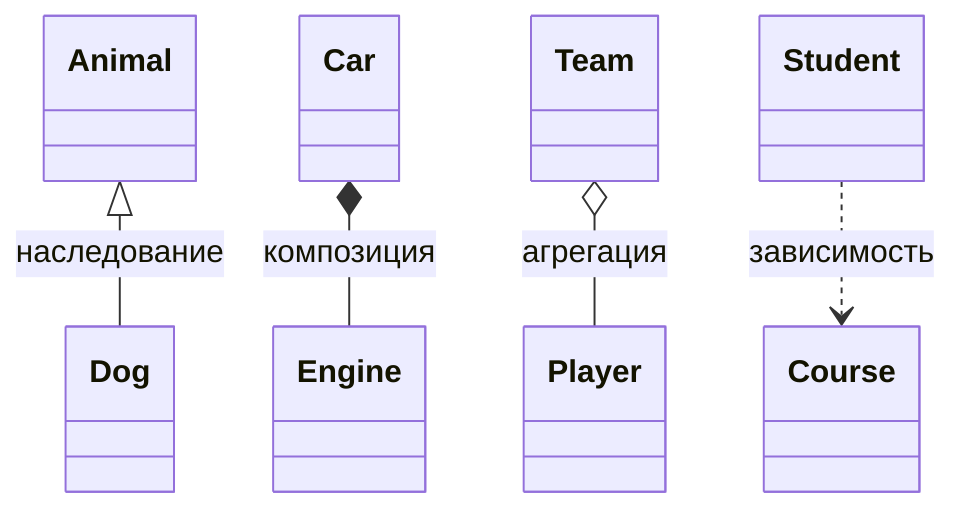

# Теория ООП

## 1. Что такое ООП

> [!note] Определение
> **Объектно-ориентированное программирование (ООП)** это парадигма, в которой программа строится как набор взаимодействующих **объектов**. Каждый объект объединяет **данные** (состояние) и **поведение** (методы), которые с этими данными работают.

### Основные парадигмы программирования

| Парадигма | Основная идея | Пример |
|---|---|---|
| Процедурная | Программа это последовательность функций | C, Pascal |
| Функциональная | Программа это композиция чистых функций | Haskell, Lisp |
| Объектно-ориентированная | Программа это взаимодействие объектов | Java, C++, Python |

> [!tip] Python мультипарадигменный
> В Python можно писать и процедурно, и функционально, и в стиле ООП. Всё в Python является объектом: числа, строки, функции, даже сами классы.

---

## 2. Ключевые понятия

- **Класс**: шаблон (чертёж), описывающий, какие данные и методы будут у объектов.
- **Объект (экземпляр)**: конкретная сущность, созданная по классу.
- **Атрибут**: переменная, принадлежащая объекту или классу.
- **Метод**: функция, определённая внутри класса.
- **Состояние**: набор значений атрибутов объекта в данный момент.
- **Поведение**: то, что объект умеет делать (его методы).
- **Идентичность**: каждый объект уникален, даже при одинаковых данных (`id(obj)`).

```python
class Dog:
    def __init__(self, name):
        self.name = name          # состояние

    def bark(self):               # поведение
        print(f"{self.name}: Гав!")

a = Dog("Рекс")
b = Dog("Рекс")
print(a == b)         # False: разные объекты (идентичность)
print(a is b)         # False
```

---

## 3. Четыре столпа ООП

### 3.1 Абстракция

> [!note] Суть
> Выделение **существенных** свойств объекта и отбрасывание несущественных. Пользователь работает с простым интерфейсом и не думает о внутренней сложности.

Пример: у кофемашины есть кнопка «Сделать кофе». Как внутри работают насос и нагреватель, пользователю знать не нужно.

```python
class CoffeeMachine:
    def make_coffee(self):          # простой интерфейс
        self._heat_water()
        self._grind_beans()
        print("Кофе готов")

    def _heat_water(self): ...      # детали скрыты
    def _grind_beans(self): ...
```

### 3.2 Инкапсуляция

> [!note] Суть
> **Объединение данных и методов** в одном объекте и **ограничение прямого доступа** к внутреннему состоянию. Изменять данные можно только через контролируемый интерфейс.

Зачем: защита от некорректных значений, свобода менять внутреннюю реализацию без поломки внешнего кода.

В Python нет жёстких модификаторов доступа, действуют **соглашения**:

| Запись | Значение |
|---|---|
| `name` | публичный атрибут |
| `_name` | «защищённый»: договорённость «не трогай снаружи» |
| `__name` | «приватный»: Python переименовывает в `_Class__name` (name mangling) |

```python
class Account:
    def __init__(self, balance):
        self.__balance = balance

    def deposit(self, amount):
        if amount <= 0:
            raise ValueError("Сумма должна быть положительной")
        self.__balance += amount

    @property
    def balance(self):
        return self.__balance

acc = Account(100)
acc.deposit(50)
print(acc.balance)     # 150
# acc.balance = 1000   # AttributeError: свойство только для чтения
```

> [!warning] Важно
> `__name` это не настоящая защита, а лишь защита от случайных конфликтов имён. Обойти её можно через `obj._Class__name`.

### 3.3 Наследование

> [!note] Суть
> Механизм, при котором новый класс (**потомок**, дочерний) получает атрибуты и методы существующего класса (**предка**, родительского) и может их расширять или переопределять.

Отношение «**является**» (*is-a*): собака *является* животным.

```python
class Animal:
    def __init__(self, name):
        self.name = name

    def speak(self):
        print("...")

class Dog(Animal):
    def speak(self):               # переопределение метода
        print(f"{self.name}: Гав!")

class Cat(Animal):
    def __init__(self, name, color):
        super().__init__(name)     # вызов конструктора родителя
        self.color = color

    def speak(self):
        print(f"{self.name}: Мяу!")
```

Виды наследования:

- **Одиночное**: один родитель.
- **Множественное**: несколько родителей (`class C(A, B)`). Порядок поиска методов определяется **MRO**.
- **Многоуровневое**: цепочка `A → B → C`.

```python
print(Cat.__mro__)   # порядок поиска методов
```

> [!question]- Когда наследование плохая идея?
> Если связь не «является», а «имеет». Двигатель не является машиной, он её часть. Здесь нужна **композиция** (см. раздел 5). Правило: *предпочитайте композицию наследованию*.

### 3.4 Полиморфизм

> [!note] Суть
> «Много форм». Один и тот же интерфейс (имя метода) работает по-разному для объектов разных классов.

```python
animals = [Dog("Рекс"), Cat("Мурка", "серая")]

for a in animals:
    a.speak()      # каждый объект отвечает по-своему
```

Виды полиморфизма в Python:

1. **Через наследование**: переопределение методов (пример выше).
2. **Утиная типизация**: «если выглядит как утка и крякает как утка, значит это утка». Важно не *тип* объекта, а наличие нужных методов.
3. **Перегрузка операторов**: через магические методы (`__add__`, `__len__` и т. д.).

```python
class Duck:
    def speak(self): print("Кряк")

class Robot:
    def speak(self): print("Бип")

for x in (Duck(), Robot()):
    x.speak()      # наследования нет, но работает
```

> [!info] Перегрузки методов (как в Java) в Python нет
> Нельзя определить два метода с одним именем и разными сигнатурами. Вместо этого используют аргументы по умолчанию, `*args`, `**kwargs`.

---

## 4. Виды методов и атрибутов

| Вид | Декоратор | Первый аргумент | Доступ к |
|---|---|---|---|
| Метод экземпляра | нет | `self` | объекту и классу |
| Метод класса | `@classmethod` | `cls` | классу |
| Статический метод | `@staticmethod` | нет | ничему автоматически |
| Свойство | `@property` | `self` | вычисляется как атрибут |

```python
class Circle:
    PI = 3.14159                    # атрибут класса

    def __init__(self, r):
        self.r = r                  # атрибут экземпляра

    def area(self):                 # метод экземпляра
        return self.PI * self.r ** 2

    @classmethod
    def unit(cls):                  # альтернативный конструктор
        return cls(1)

    @staticmethod
    def is_valid_radius(r):         # утилита, связанная по смыслу
        return r > 0
```

---

## 5. Отношения между классами



| Отношение | Смысл | Жизненный цикл | Пример |
|---|---|---|---|
| **Наследование** | A *является* B | : | Dog → Animal |
| **Композиция** | A *состоит из* B, часть не живёт отдельно | связан | Дом и комнаты |
| **Агрегация** | A *содержит* B, часть может жить отдельно | независим | Команда и игроки |
| **Ассоциация** | A *использует* B | независим | Врач и пациент |
| **Зависимость** | A временно использует B (аргумент метода) | : | Метод принимает объект |

```python
class Engine:
    def start(self): print("Вррр")

class Car:
    def __init__(self):
        self.engine = Engine()      # композиция: Car создаёт и владеет Engine

    def drive(self):
        self.engine.start()
```

---

## 6. Абстрактные классы и интерфейсы

> [!note] Суть
> **Абстрактный класс** нельзя инстанцировать. Он задаёт контракт: какие методы обязаны реализовать потомки.

```python
from abc import ABC, abstractmethod

class Shape(ABC):
    @abstractmethod
    def area(self): ...

class Square(Shape):
    def __init__(self, a): self.a = a
    def area(self): return self.a ** 2

# Shape()      # TypeError: нельзя создать экземпляр абстрактного класса
print(Square(3).area())   # 9
```

---

## 7. Жизненный цикл объекта

1. `__new__(cls, ...)`: **создаёт** объект (редко переопределяется).
2. `__init__(self, ...)`: **инициализирует** созданный объект.
3. Использование объекта.
4. `__del__(self)`: вызывается при удалении (на него лучше не полагаться).

Память управляется автоматически: **подсчёт ссылок** плюс сборщик мусора. Когда на объект не остаётся ссылок, он удаляется.

---

## 8. Принципы хорошего проектирования

> [!important] SOLID
> | Буква | Принцип | Идея |
> |---|---|---|
> | **S** | Single Responsibility | У класса одна причина для изменения |
> | **O** | Open/Closed | Открыт для расширения, закрыт для изменения |
> | **L** | Liskov Substitution | Потомка можно подставить вместо предка без поломок |
> | **I** | Interface Segregation | Много узких интерфейсов лучше одного широкого |
> | **D** | Dependency Inversion | Зависеть от абстракций, а не от конкретных классов |

Другие важные принципы:

- **DRY** (Don't Repeat Yourself): не дублируйте код.
- **KISS** (Keep It Simple): не усложняйте без нужды.
- **YAGNI** (You Aren't Gonna Need It): не пишите то, что пока не требуется.
- **Композиция вместо наследования.**
- **Закон Деметры**: объект общается только с «ближайшими друзьями», а не с цепочкой `a.b.c.d.method()`.

---

## 9. Плюсы и минусы ООП

| ✅ Плюсы | ❌ Минусы |
|---|---|
| Структурированность больших проектов | Избыточность для маленьких задач |
| Повторное использование кода | Риск «раздутых» иерархий наследования |
| Удобство сопровождения и расширения | Чуть ниже производительность |
| Моделирование реального мира | Порог входа выше, чем у процедурного кода |

---

## 10. Словарь терминов

| Термин | Значение |
|---|---|
| Instance | экземпляр класса |
| Constructor | конструктор (`__init__` / `__new__`) |
| Override | переопределение метода в потомке |
| Overload | перегрузка (в Python эмулируется) |
| Mixin | класс-примесь, добавляющий поведение |
| MRO | порядок разрешения методов |
| Dunder | «двойное подчёркивание», магический метод (`__str__`) |
| Duck typing | утиная типизация |
| Composition | композиция |
| Interface | набор методов, которые обязан реализовать класс |

---

Предлагаю идти от простого к сложному. Каждый урок: теория, примеры, задания, решения в конце.

|№|Тема|
|---|---|
|1|Классы и объекты, `__init__`, `self`, атрибуты класса и экземпляра|
|2|Инкапсуляция, `@property`, геттеры и сеттеры|
|3|Наследование, `super()`, MRO, множественное наследование|
|4|Полиморфизм, абстрактные классы (`abc`), утиная типизация|
|5|`@classmethod`, `@staticmethod`, способы создания объектов|
|6|**Магические методы I:** `__str__`, `__repr__`, сравнение, `__eq__`, `__hash__`|
|7|**Магические методы II:** арифметика (`__add__`, `__mul__`...), `__bool__`, `__len__`|
|8|**Магические методы III:** контейнеры (`__getitem__`, `__iter__`), `__call__`, `__enter__`/`__exit__`|
|9|`dataclasses`, `__slots__`, `__getattr__`, `__setattr__`|
|10|Дескрипторы, метаклассы (продвинутый уровень)|
|11|Принципы SOLID и основные паттерны проектирования|
|12|Итоговый проект: персептрон как класс с обучением|

---

## Урок 1. Классы и объекты

### 1. Зачем нужно ООП

Без ООП данные и функции живут отдельно:

python

```python
student_name = "Анна"
student_grades = [5, 4, 5]

def average(grades):
    return sum(grades) / len(grades)
```

Когда студентов становится много, такой код превращается в хаос. ООП объединяет **данные** (атрибуты) и **поведение** (методы) в одну сущность.

- **Класс** — чертёж, шаблон («что такое студент»).
- **Объект (экземпляр)** — конкретная вещь, созданная по чертежу («студентка Анна»).

### 2. Первый класс

python

```python
class Student:
    def __init__(self, name, grades):
        self.name = name
        self.grades = grades

    def average(self):
        return sum(self.grades) / len(self.grades)


anna = Student("Анна", [5, 4, 5])
ivan = Student("Иван", [3, 4, 3])

print(anna.name)       # Анна
print(anna.average())  # 4.666...
print(ivan.average())  # 3.333...
```

### 3. Разбор по частям

**`class Student:`** объявляет класс. Имена классов принято писать в `CamelCase`.

**`__init__`** — _инициализатор_. Вызывается автоматически при создании объекта: `Student("Анна", [5, 4, 5])` запускает `__init__` с этими аргументами. Это первый «магический» метод (с двойными подчёркиваниями), их будет много.

**`self`** — ссылка на текущий объект. Python передаёт её первым аргументом автоматически:

python

```python
anna.average()
# то же самое, что:
Student.average(anna)
```

Поэтому `self` указывается в определении метода, но не передаётся при вызове.

**`self.name = name`** создаёт **атрибут экземпляра**: у каждого объекта свой.

### 4. Атрибуты класса и экземпляра

python

```python
class Student:
    school = "Школа №5"          # атрибут КЛАССА — общий для всех

    def __init__(self, name):
        self.name = name         # атрибут ЭКЗЕМПЛЯРА — свой у каждого


a = Student("Анна")
b = Student("Иван")

print(a.school, b.school)   # Школа №5 Школа №5

Student.school = "Лицей №1"
print(a.school, b.school)   # Лицей №1 Лицей №1  (изменилось у всех)

a.school = "Гимназия"       # создаёт атрибут экземпляра, который "перекрывает" классовый
print(a.school, b.school)   # Гимназия Лицей №1
```

> ⚠️ **Типичная ловушка:** изменяемые значения (списки, словари) в атрибуте класса будут общими для всех объектов.

python

```python
class Bad:
    items = []                 # один список на всех!

    def add(self, x):
        self.items.append(x)

x, y = Bad(), Bad()
x.add(1)
print(y.items)  # [1]  ← неожиданно!
```

Правильно создавать такие данные в `__init__`: `self.items = []`.

### 5. Как Python ищет атрибут

При обращении `obj.attr` Python ищет в таком порядке:

1. в самом объекте (`obj.__dict__`);
2. в классе объекта;
3. в родительских классах.

python

```python
print(anna.__dict__)   # {'name': 'Анна', 'grades': [5, 4, 5]}
```

### 6. Методы: что в них можно делать

python

```python
class Counter:
    def __init__(self):
        self.value = 0

    def increment(self, step=1):
        self.value += step
        return self            # возвращаем сам объект — можно строить цепочки

    def reset(self):
        self.value = 0


c = Counter()
c.increment().increment(5).increment()
print(c.value)  # 7
```

### 7. Полезные встроенные функции для объектов

python

```python
isinstance(anna, Student)   # True — является ли объект экземпляром класса
type(anna)                  # <class '__main__.Student'>
hasattr(anna, "name")       # True
getattr(anna, "age", 18)    # 18 — значение по умолчанию, если атрибута нет
setattr(anna, "age", 20)    # то же, что anna.age = 20
dir(anna)                   # список всех атрибутов и методов
```

### 8. Проблема: объект выводится «некрасиво»

python

```python
print(anna)   # <__main__.Student object at 0x000001A2B3C4D5E0>
```

Это решается магическим методом `__str__`, который мы подробно разберём в уроке 6. Пока достаточно знать, что у каждого объекта есть такое «поведение по умолчанию», которое можно переопределять.

---

## Задания к уроку 1

**Задание 1.** Создайте класс `Rectangle` с атрибутами `width` и `height` и методами `area()` (площадь) и `perimeter()` (периметр).

**Задание 2.** Создайте класс `BankAccount` с атрибутом `balance` (по умолчанию 0) и методами `deposit(amount)`, `withdraw(amount)` и `get_balance()`. При попытке снять больше, чем есть на счёте, выводите сообщение «Недостаточно средств» и не меняйте баланс.

**Задание 3.** Добавьте в `BankAccount` атрибут класса `bank_name = "PyBank"` и счётчик `accounts_count`, который увеличивается при создании каждого нового счёта.

**Задание 4.** Найдите ошибку и объясните, почему так происходит:

python

```python
class Team:
    members = []

    def add(self, name):
        self.members.append(name)

t1 = Team()
t2 = Team()
t1.add("Анна")
print(t2.members)
```

---

## 📌 Решения

python

```python
# ---------- Задание 1 ----------
class Rectangle:
    def __init__(self, width, height):
        self.width = width
        self.height = height

    def area(self):
        return self.width * self.height

    def perimeter(self):
        return 2 * (self.width + self.height)

r = Rectangle(4, 6)
print(r.area())       # 24
print(r.perimeter())  # 20


# ---------- Задание 2 и 3 ----------
class BankAccount:
    bank_name = "PyBank"
    accounts_count = 0

    def __init__(self, balance=0):
        self.balance = balance
        BankAccount.accounts_count += 1

    def deposit(self, amount):
        self.balance += amount

    def withdraw(self, amount):
        if amount > self.balance:
            print("Недостаточно средств")
        else:
            self.balance -= amount

    def get_balance(self):
        return self.balance

acc1 = BankAccount(100)
acc2 = BankAccount()
acc1.withdraw(500)            # Недостаточно средств
acc1.deposit(50)
print(acc1.get_balance())     # 150
print(BankAccount.accounts_count)  # 2


# ---------- Задание 4 ----------
# Ответ: members — атрибут КЛАССА, список создаётся один раз и общий для всех
# экземпляров. Вывод: ['Анна'] (хотя добавляли в t1, а смотрим t2).
# Исправление:
class Team:
    def __init__(self):
        self.members = []     # свой список у каждого объекта

    def add(self, name):
        self.members.append(name)
```

---

Попробуйте решить задания сами, а потом присылайте свои решения, я их проверю и разберу ошибки. Когда будете готовы, переходим к уроку 2 (инкапсуляция и `@property`).

И один вопрос по формату: оформлять уроки сразу в виде заметок для Obsidian, как раньше?
