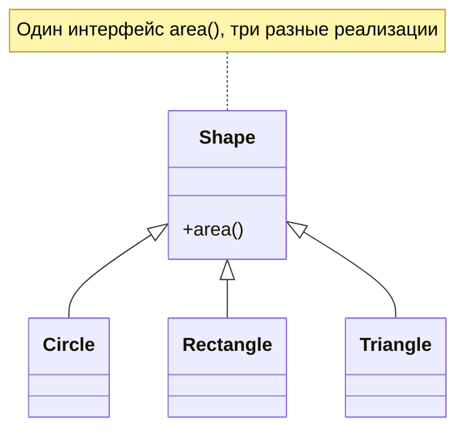

## 1. Идея

> [!note] Определение
> **Полиморфизм** (от греч. «много форм») это способность разных объектов отвечать на **один и тот же вызов** каждый по-своему. Код обращается к объектам через общий интерфейс и не знает, какой именно тип перед ним.

> [!tip] Аналогия
> Кнопка «Play». На телевизоре, в плеере и в смартфоне она означает «воспроизвести». Вы нажимаете одно и то же, а внутри у каждого устройства своя реализация.

```python
for item in ["abc", [1, 2, 3], {"a": 1}, (1, 2)]:   # объекты РАЗНЫХ типов
    print(len(item))                                  # один и тот же вызов len()
# 3, 3, 1, 2
```

> [!info] Разбор
> Функция `len` не проверяет, строка перед ней или список. Она просит объект сообщить свою длину, и каждый тип отвечает по-своему. Это и есть полиморфизм.

### Зачем он нужен

| Без полиморфизма | С полиморфизмом |
|---|---|
| Длинные цепочки `if isinstance(...)` | Один вызов, объект сам знает, что делать |
| Новый тип требует правки старого кода | Новый тип просто добавляется |
| Код привязан к конкретным классам | Код зависит от интерфейса |
| Трудно тестировать (нужны настоящие зависимости) | Легко подставить заглушку |

### Позднее связывание (late binding)

> [!important] Ключевая идея
> В Python метод выбирается **во время выполнения** по реальному типу объекта, а не по тому, как названа переменная или что написано в аннотации.

```python
class Animal:
    def speak(self):
        return "..."

class Dog(Animal):
    def speak(self):
        return "Гав"

pet: Animal = Dog()     # аннотация говорит Animal, но объект на самом деле Dog
print(pet.speak())      # Гав: решает реальный тип
```

---

## 2. Виды полиморфизма

| Вид | Суть | Как выглядит в Python |
|---|---|---|
| **Полиморфизм подтипов** (включающий) | Потомок подставляется вместо предка | Наследование и переопределение методов |
| **Утиный** (структурный) | Важно наличие нужных методов, а не тип | Любые классы с нужным методом |
| **Ad hoc** (специальный, «перегрузка») | Разное поведение для разных типов аргументов | Операторы (`+`), `singledispatch` |
| **Параметрический** | Один код работает с любым типом данных | Generics (`TypeVar`, `Generic`) |
| **Приведение типов** (coercion) | Автоматическое преобразование | `1 + 2.5` (int превращается в float) |



> [!tip] Динамический и статический
> **Динамический** полиморфизм: выбор реализации во время работы программы (переопределение, утиная типизация). **Статический**: выбор при компиляции (перегрузка функций в C++/Java). В Python по сути только динамический, а статические проверки добавляют анализаторы типов (mypy, pyright).

---

## 3. Полиморфизм повсюду: встроенные функции и операторы

Python уже полон полиморфизма:

```python
print(2 + 3)                  # 5          сложение чисел
print("a" + "b")              # ab         конкатенация строк
print([1] + [2])              # [1, 2]     объединение списков
print(3 * 4)                  # 12
print("ab" * 3)               # ababab     повтор строки
print([0] * 3)                # [0, 0, 0]  повтор списка

print(max(3, 7))              # 7          числа
print(max("a", "z"))          # z          строки сравниваются лексикографически
print(max([1, 5], [1, 7]))    # [1, 7]     списки сравниваются поэлементно

print(sorted([3, 1, 2]))      # числа
print(sorted(["b", "a"]))     # строки
```

> [!info] Разбор
> Оператор `+` не «знает» ни про числа, ни про строки. Он вызывает `a.__add__(b)`, и каждый тип реализует это по-своему. Так же устроены `len()` (`__len__`), `str()` (`__str__`), `iter()` (`__iter__`) и другие.

| Функция/оператор | Что вызывается внутри |
|---|---|
| `len(x)` | `x.__len__()` |
| `str(x)`, `print(x)` | `x.__str__()` |
| `x + y` | `x.__add__(y)` |
| `x == y` | `x.__eq__(y)` |
| `x[i]` | `x.__getitem__(i)` |
| `for a in x` | `x.__iter__()` |
| `x(...)` | `x.__call__(...)` |
| `with x:` | `x.__enter__()` и `x.__exit__()` |
| `bool(x)` | `x.__bool__()` или `__len__()` |
| `hash(x)` | `x.__hash__()` |

---

## 4. Полиморфизм подтипов (через наследование)

### 4.1 Базовый пример

```python
class Shape:
    def area(self):                       # общий интерфейс
        raise NotImplementedError("Потомок обязан реализовать area()")

    def describe(self):                   # общая логика на базе интерфейса
        return f"{type(self).__name__} с площадью {self.area():.2f}"


class Circle(Shape):
    def __init__(self, r):
        self.r = r

    def area(self):                       # своя реализация
        return 3.14159 * self.r ** 2


class Rectangle(Shape):
    def __init__(self, w, h):
        self.w, self.h = w, h

    def area(self):                       # другая реализация
        return self.w * self.h


shapes = [Circle(1), Rectangle(3, 4), Circle(2)]    # список из РАЗНЫХ типов

for s in shapes:
    print(s.describe())                  # код цикла не знает, какая это фигура

total = sum(s.area() for s in shapes)    # работаем с группой как с единым целым
```

> [!info] Разбор
> `describe` написан **один раз** в базовом классе, но вызывает `self.area()`, и каждая фигура подставляет свою версию. Это основа паттерна «шаблонный метод» (раздел 13). Новая фигура (например, `Triangle`) заработает без единой правки `describe` или цикла.

### 4.2 Расширение через `super()`

```python
class Employee:
    def __init__(self, name, salary):
        self.name, self.salary = name, salary

    def pay(self):
        return self.salary

class Manager(Employee):
    def __init__(self, name, salary, bonus):
        super().__init__(name, salary)
        self.bonus = bonus

    def pay(self):
        return super().pay() + self.bonus   # расширяем поведение предка, а не заменяем

staff = [Employee("Олег", 100), Manager("Анна", 200, 50)]
print([e.pay() for e in staff])             # [100, 250]
```

### 4.3 Полиморфизм и `isinstance`

```python
d = Dog()
print(isinstance(d, Animal))     # True: Dog можно использовать там, где ждут Animal
```

> [!tip] Правило подстановки
> Везде, где ожидается предок, можно передать потомка. Это основа полиморфизма подтипов, и она же требует, чтобы потомок **не ломал** обещания предка (принцип Лисков, раздел 15).

---

## 5. Утиная типизация (duck typing)

> [!quote] Принцип
> «Если нечто ходит как утка и крякает как утка, значит это утка». Python не спрашивает «**кто ты**», он спрашивает «**что ты умеешь**».

```python
class Duck:
    def speak(self):
        return "Кря"

class Robot:                              # НИКАКОГО общего предка!
    def speak(self):
        return "Бип"

class Person:
    def speak(self):
        return "Привет"

def make_it_speak(thing):                 # нет проверки типа: нужен только метод speak
    print(thing.speak())

for obj in (Duck(), Robot(), Person()):
    make_it_speak(obj)                    # работает для всех
```

> [!info] Разбор
> Классы не связаны наследованием, но функция работает со всеми, потому что у каждого есть `speak()`. Это более гибкий вариант, чем «все должны наследовать общий класс».

### 5.1 Знакомые примеры утиной типизации

```python
# Файлоподобные объекты: всё, что имеет write(), годится как "файл"
import io, sys

def save(text, out):
    out.write(text)                       # что такое out? файл? буфер? сокет? неважно

save("привет\n", sys.stdout)              # консоль
buf = io.StringIO()
save("привет", buf)                       # строка в памяти
print(buf.getvalue())

# Итерируемые объекты: цикл for принимает всё, что умеет отдавать элементы
for x in [1, 2]: ...
for x in (1, 2): ...
for x in {1, 2}: ...
for x in "ab": ...
for x in {"k": 1}: ...                    # ключи
for x in range(3): ...
for x in open("file.txt"): ...            # строки файла
```
> Задание 1: Фигуры
> Базовый класс `Shape` с методом `area()`, который выбрасывает `NotImplementedError`. Потомки `Circle`, `Rectangle`, `Triangle`. Функция `total_area(shapes)` и функция `largest(shapes)`, возвращающая фигуру с наибольшей площадью.

> Задание 2: Утиная типизация
> Классы `Duck`, `Robot`, `Person` с разными реализациями метода `speak()` без общего предка. Функция `make_it_speak(obj)` в стиле EAFP: если у объекта нет `speak`, возвращает `"молчит"`. Проверьте на `Duck`, `Robot` и на числе `42`.

> Задание 3: Предскажите вывод (конструктор)
> ```python
> class Base:
>     def __init__(self):
>         self.setup()
>     def setup(self):
>         print("Base setup")
>
> class Child(Base):
>     def __init__(self):
>         super().__init__()
>         self.value = 10
>     def setup(self):
>         print("Child setup", self.value)
>
> Child()
> ```
> Что произойдёт? Предложите два способа исправления.
> 

